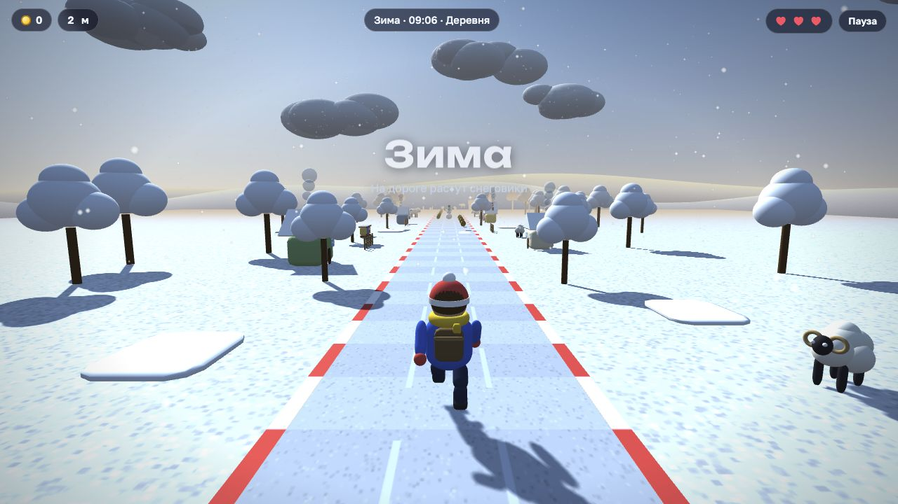
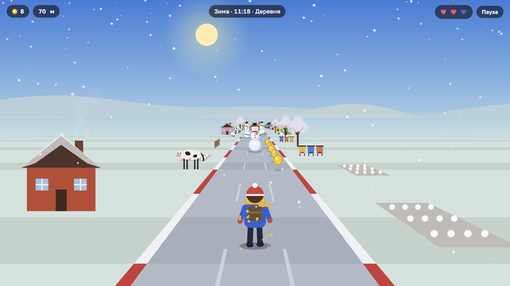
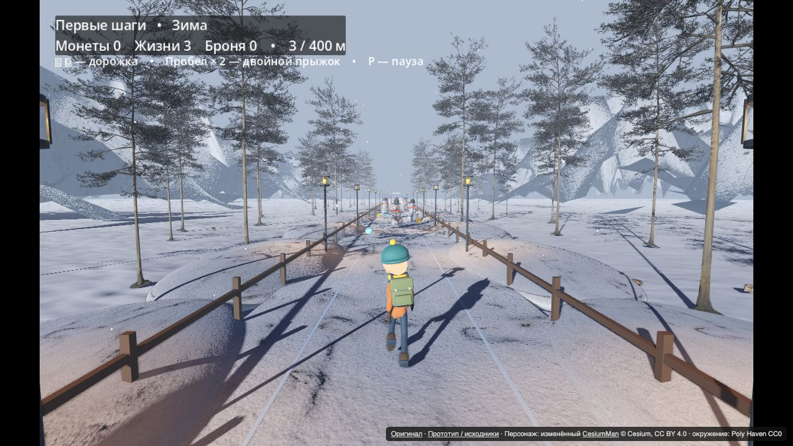

# Бег сквозь сезоны

Раннер в нескольких версиях — от браузерных 2D и 3D до экспериментов с Godot и Unreal Engine: беги по дороге, уворачивайся от снеговиков и грязевиков, собирай монетки и проходи уровни. Вокруг сменяются времена года, время суток и края: деревни, луга, горы, море, реки и снежные долины.

Играть без установки: **[3D в браузере](https://dermanov-ru.github.io/season-run/)** · **[2D в браузере](https://dermanov-ru.github.io/season-run/2d.html)** · [Godot-прототип](https://dermanov-ru.github.io/season-run/godot/)

[Посмотреть Unreal-версию и её исходники](#unreal-engine--бесконечный-зимний-забег)

- `index.html` — 3D-версия (Three.js) с уровнями, бронёй и сюрпризами
- `2d.html` — первая 2D-версия

Управление: ← → или A/D — дорожка, ↑ или пробел — прыжок (дважды — двойной прыжок), P — пауза. На телефоне — свайпы.

## Браузерная 3D-версия

[Играть на GitHub Pages](https://dermanov-ru.github.io/season-run/) — оригинальный раннер на Three.js с уровнями, бесконечным режимом, сезонами, бронёй и сюрпризами.

## Браузерная 2D-версия

[Играть на GitHub Pages](https://dermanov-ru.github.io/season-run/2d.html) — первая версия с рисованной дорогой и персонажами на Canvas.

## Godot-прототип

[Играть в браузере](https://dermanov-ru.github.io/season-run/godot/) — текущая незавершённая Godot-версия с зимним окружением и анимированным бегуном. Лучше открывать на компьютере: Enter — старт, ← → / A D — дорожка, пробел / ↑ — двойной прыжок, P — пауза, R — заново.

Веб-версия использует Compatibility/WebGL 2 и упрощённое освещение; объёмный туман и SSAO из настольной Forward+ версии здесь недоступны. Это прототип для сравнения графики, не полный перенос всех окружений и механик оригинала. Загрузка включает движок WebAssembly и модели, поэтому первый запуск может занять некоторое время.

- `godot/` — опубликованная браузерная сборка.
- `godot-source/` — редактируемый проект Godot 4.7.2. Для открытия импортируйте `project.godot`.
- Исходные Three.js и 2D-версии доступны по прежним ссылкам.

Модели/текстуры: Poly Haven (CC0). Зимний бегун — изменённый CesiumMan, ©2017 Cesium, CC BY 4.0. Ссылки и сведения об изменениях — в [описании Godot-проекта](godot-source/README.md).

## Unreal Engine — бесконечный зимний забег

**[▶ Посмотреть короткое видео без установки](https://dermanov-ru.github.io/season-run/unreal.html)** · [Видео на VideoHub](https://videohub.dermanov.ru/watch/627af461c86e635c)

https://github.com/user-attachments/assets/77caf5f1-9e3f-4157-83aa-0c647860b82e

30 секунд игрового демо: разгон на стрелках, снеговики, двойные прыжки через ямы и подбор сердечек. Музыка добавлена к записи; видеоряд записан непрерывно. Автоматическое управление используется только для демонстрации.

[Редактируемый проект и описание](unreal-source/README.md) — нативный прототип на Unreal Engine 5.8. Здесь он представлен исходниками, скриншотом и видео: браузерной сборки и отдельного скачивания игры нет.

- Бесконечный забег: трасса повторяется без загрузочного экрана, а пройденные метры продолжают считаться.
- Солнечный день плавно сменяется ночью; ночью появляются звёзды и созвездия.
- Снеговики и грязевики, физические ямы для прыжков, монеты и подбираемые сердечки. Снежков нет.
- Каждая стрелка плавно и навсегда добавляет 7,2 км/ч, без максимальной скорости.
- Панель с иконками скорости, монет и здоровья; рекорды по метрам и монетам и общий запас монет сохраняются локально.
- Музыка, звуки подбора, расширение обзора и эффекты скорости.

`unreal-source/` содержит C++-код, `.uproject`, настройки, материалы, окружение, музыку и инструменты подготовки. Кэши, готовые сборки и личные сохранения в репозиторий не входят. Персонаж из Stack O Bot подключается отдельно из собственного проекта Fab; инструкция — в [README Unreal-проекта](unreal-source/README.md#персонаж-stack-o-bot).

Это прототип для сравнения графики и движков: окружение пока зимнее, полный перенос всех сезонов и возможностей браузерной версии ещё не выполнен.
