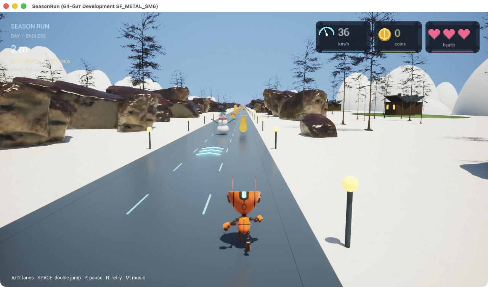

# Season Run — Unreal Engine

Нативный C++-прототип на Unreal Engine 5.8. В основном [README](../README.md) есть браузерные игры для запуска без установки; эта папка хранит редактируемый Unreal-проект, а не готовую игру для скачивания.

**[▶ Смотреть игровое видео](https://dermanov-ru.github.io/season-run/unreal.html)** · [VideoHub](https://videohub.dermanov.ru/watch/627af461c86e635c)



## Возможности

Три дорожки, двойной прыжок, бесконечный забег с повторением трассы длиной 1,2 км, монеты, три жизни, временная защита после удара и сердечки для лечения. Снеговики и грязевики появляются и двигаются на дороге; бросков снежков нет. Ямы в отдельных дорожках можно обойти, разрывы всей дороги нужно перепрыгивать.

Стартовая скорость — 36 км/ч. Каждая стрелка навсегда добавляет 7,2 км/ч, причём персонаж разгоняется плавно. Скорость растёт только от ускорителей и не имеет игрового ограничения. Поле зрения и эффекты скорости усиливаются; интенсивность визуальных эффектов ограничена для читаемости дороги.

День и ночь плавно сменяются в цикле 100 секунд; ночью видны созвездия. По бокам дороги — лес, скалы, дома и луга. Графическая панель справа показывает скорость, монеты и здоровье. Музыка и звуки монет/ускорения включены.

Лучшие метры, лучший сбор монет за забег и общий запас монет сохраняются каждые пять секунд, при паузе, проигрыше, перезапуске и штатном выходе. Файл: `Saved/SaveGames/SeasonRunProgress.sav`, исключён из Git.

## Содержимое

- `SeasonRun.uproject`, `Source/`, `Config/` — проект, игровая логика, проверки и настройки.
- `Content/Runner/` — материалы, импортированные модели/текстуры окружения и аудио.
- `Audio/` — исходные WAV-файлы музыки и эффектов.
- `Tools/` — генераторы музыки, инструменты повторного импорта и подключения персонажа.
- `Играть в Season Run.command` — локальный запуск на Mac с установленным Unreal Engine.

Готовые сборки, движок, кэши, локальные сохранения и исходные ассеты Stack O Bot здесь не распространяются. Сцена создаётся кодом при старте через `/Engine/Maps/Entry`; отдельная карта `.umap` не нужна.

## Персонаж Stack O Bot

На скриншоте используется робот и анимация бега из [Stack O Bot от Epic Games](https://www.fab.com/listings/b4dfff49-0e7d-4c4b-a6c5-8a0315831c9c). Его исходные `.uasset` не включены в публичный репозиторий. Для такого же персонажа получите образец через Fab в своём аккаунте и создайте его локальный проект совместимой версии (5.6 или новее).

Из папки `unreal-source` выполните:

```sh
python3 Tools/copy_stackobot.py "/путь/к/StackOBot/StackOBot.uproject"
```

Инструмент сначала проверяет наличие всех зависимостей, затем копирует только необходимые файлы. Они остаются локальными: `Content/StackOBot/` исключена из Git. Альтернатива — перенести соответствующие ассеты с зависимостями через Migrate в редакторе; список — `Tools/stackobot-assets.json`.

## Локальный запуск

Нужны Unreal Engine 5.8 и инструменты C++ для выбранной платформы; на Mac — Apple Silicon и Xcode. После подключения персонажа откройте `SeasonRun.uproject` и соберите модуль, либо запустите `Играть в Season Run.command`. Скрипт Mac по умолчанию ищет движок в `/Users/Shared/Epic Games/UE_5.8`; другую папку можно передать через `SEASON_RUN_UE_ROOT`.

Enter — начать; A/D или стрелки — дорожка; пробел/↑ — прыжок (дважды для двойного); P — пауза; R — заново; M — музыка.

## Ассеты и звук

- Окружение: [pine_tree_01](https://polyhaven.com/a/pine_tree_01), [rock_07](https://polyhaven.com/a/rock_07), [snow_02](https://polyhaven.com/a/snow_02) от Poly Haven, CC0. Импортировано из ресурсов Godot-прототипа этого же репозитория.
- Робот: Stack O Bot / Epic Games, отдельная зависимость по лицензии образца. См. [условия Fab](https://www.fab.com/eula?lang=en).
- Музыка Winter Pulse и Night Flight, звуки монеты и ускорителя созданы для проекта; исходные генераторы находятся в `Tools/`. Для генерации нужен Python с NumPy.
- Импортированные `Content/Runner` уже включены. Скрипты Unreal Python нужны только для изменения/повторного импорта: окружение → материалы → аудио/ночные материалы → `prepare_cycle.py` → `finalize_material_usage.py`. Последние два шага обеспечивают смену дня/ночи и нужные флаги материалов.

## Проверки и ограничения

Встроенные проверки `SeasonRun.*` покрывают столкновения, смену дорожек, прыжки, ямы, лечение, накопительный разгон, день/ночь и сериализацию прогресса. На Mac с UE 5.8.3 прошли все шесть групп. Отдельная проверка `-RunnerVerify` запускает настоящий подбор сердечка, повтор трассы и сохранение/загрузку без повторного начисления монет, используя изолированный слот `SeasonRunVerification`.

Это прототип с повторяющейся зимней трассой. Все сезонные окружения, уровни, броня и сюрпризы исходной браузерной игры пока не перенесены. Браузерного экспорта Unreal в этом репозитории нет.

### Запись демонстрации

Параметр `-RunnerTrailer` включает автоматический показ обычного забега: ускорители, столкновение и восстановление сердечком, обход препятствий и двойные прыжки. Режим не меняет сохранённые рекорды. Без этого параметра управление остаётся ручным.
